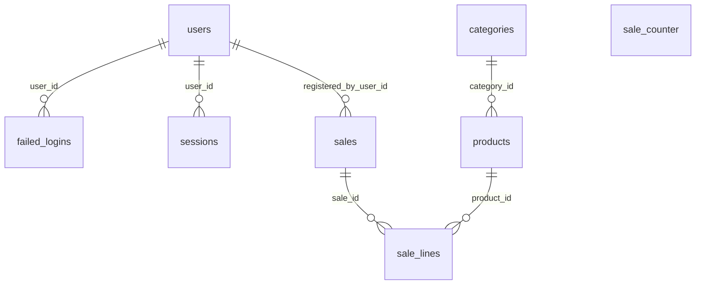

---
tags:
  - tabla
---

# Base de datos

> [!info] Nota generada
> Generada desde `origin/develop` (34161f1, 2026-10-29) con `npm run mapa`. No la edites: se reescribe en cada ejecución. Lo tuyo va en `Notas/`.

PostgreSQL (Neon). Solo `apps/api/src/shared/database` habla con la base; ver [[Arquitectura]] §6.4.

| Tabla | Migración | Referencia a | Archivos que la usan |
| --- | --- | --- | --- |
| [[Tabla users]] | [001_auth.sql](https://github.com/Tutuma-jar/kofi-pos-v2/blob/develop/apps/api/src/shared/database/migrations/001_auth.sql) | — | 2 |
| [[Tabla failed_logins]] | [001_auth.sql](https://github.com/Tutuma-jar/kofi-pos-v2/blob/develop/apps/api/src/shared/database/migrations/001_auth.sql) | [[Tabla users]] | 1 |
| [[Tabla sessions]] | [001_auth.sql](https://github.com/Tutuma-jar/kofi-pos-v2/blob/develop/apps/api/src/shared/database/migrations/001_auth.sql) | [[Tabla users]] | 1 |
| [[Tabla categories]] | [002_menu.sql](https://github.com/Tutuma-jar/kofi-pos-v2/blob/develop/apps/api/src/shared/database/migrations/002_menu.sql) | — | 3 |
| [[Tabla products]] | [002_menu.sql](https://github.com/Tutuma-jar/kofi-pos-v2/blob/develop/apps/api/src/shared/database/migrations/002_menu.sql) | [[Tabla categories]] | 3 |
| [[Tabla sale_counter]] | [003_sales.sql](https://github.com/Tutuma-jar/kofi-pos-v2/blob/develop/apps/api/src/shared/database/migrations/003_sales.sql) | — | 3 |
| [[Tabla sales]] | [003_sales.sql](https://github.com/Tutuma-jar/kofi-pos-v2/blob/develop/apps/api/src/shared/database/migrations/003_sales.sql) | [[Tabla users]] | 2 |
| [[Tabla sale_lines]] | [003_sales.sql](https://github.com/Tutuma-jar/kofi-pos-v2/blob/develop/apps/api/src/shared/database/migrations/003_sales.sql) | [[Tabla sales]], [[Tabla products]] | 1 |
