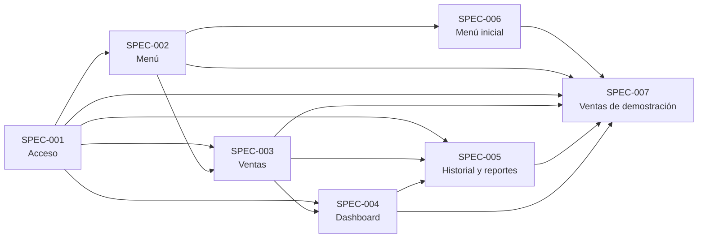

---
tags:
  - mapa
---

# Kofi POS — mapa del proyecto

> [!info] Nota generada
> Generada desde `origin/develop` (34161f1, 2026-10-29) con `npm run mapa`. No la edites: se reescribe en cada ejecución. Lo tuyo va en `Notas/`.

> [!summary] Qué es
> Kofi POS es el sistema web de punto de venta de Kofi, una cafetería ficticia que representa un pequeño emprendimiento gastronómico común en Bolivia.

Repositorio: [Tutuma-jar/kofi-pos-v2](https://github.com/Tutuma-jar/kofi-pos-v2) · rama `develop` · commit `34161f1` del 2026-10-29.

## Documentos base

- [[Constitución]] — [docs/constitution.md](https://github.com/Tutuma-jar/kofi-pos-v2/blob/develop/docs/constitution.md)
- [[Reglas de negocio]] — [docs/business-rules.md](https://github.com/Tutuma-jar/kofi-pos-v2/blob/develop/docs/business-rules.md)
- [[Arquitectura]] — [docs/architecture.md](https://github.com/Tutuma-jar/kofi-pos-v2/blob/develop/docs/architecture.md)
- [[Reglas de trabajo (AGENTS)]] — [AGENTS.md](https://github.com/Tutuma-jar/kofi-pos-v2/blob/develop/AGENTS.md)

## Especificaciones

| Especificación | Estado | Tareas | Avance | Depende de | PRs |
| --- | --- | --- | --- | --- | --- |
| [[SPEC-001 Acceso]] | revisada | 46/46 | completa | — | 4 |
| [[SPEC-002 Menú]] | revisada | 45/45 | completa | SPEC-001 | 7 |
| [[SPEC-003 Ventas]] | revisada | 35/35 | completa | SPEC-001, SPEC-002 | 6 |
| [[SPEC-004 Dashboard]] | revisada | 34/34 | completa | SPEC-001, SPEC-003 | 5 |
| [[SPEC-005 Historial y reportes]] | revisada | 38/38 | completa | SPEC-001, SPEC-003, SPEC-004 | 6 |
| [[SPEC-006 Menú inicial]] | revisada | 8/8 | completa | SPEC-002 | 3 |
| [[SPEC-007 Ventas de demostración]] | revisada | 12/12 | completa | SPEC-006, SPEC-002, SPEC-001, SPEC-003, SPEC-005, SPEC-004 | 3 |

### Dependencias entre especificaciones

## Módulos del código

| Módulo | Qué hace | Rutas API | Rutas interfaz | Especificaciones |
| --- | --- | --- | --- | --- |
| [[Módulo Acceso (auth)]] | Iniciar y cerrar sesión | 3 | 2 | SPEC-001 |
| [[Módulo Dashboard (dashboard)]] | Resumen de las ventas del día y del mes | 2 | 1 | SPEC-004 |
| [[Módulo Historial y reportes (history)]] | Consultar ventas pasadas | 4 | 3 | SPEC-005 |
| [[Módulo Menú (menu)]] | Administrar productos y categorías | 10 | 2 | SPEC-002, SPEC-003, SPEC-006, SPEC-007 |
| [[Módulo Ventas (sales)]] | Preparar y registrar ventas pagadas | 2 | 1 | SPEC-003, SPEC-004, SPEC-005, SPEC-007 |

## Vistas transversales

- [[Rutas]] — 21 rutas de la API y 9 de la interfaz.
- [[Base de datos]] — 8 tablas en 3 migraciones.
- [[Contratos]] — 8 archivos en `packages/contracts`.
- [[Historial de PRs]] — 54 commits en `develop`.

## Notas propias

Escribe en `Notas/`: el generador no las toca. Enlaza desde ahí a cualquier nota de este mapa.
